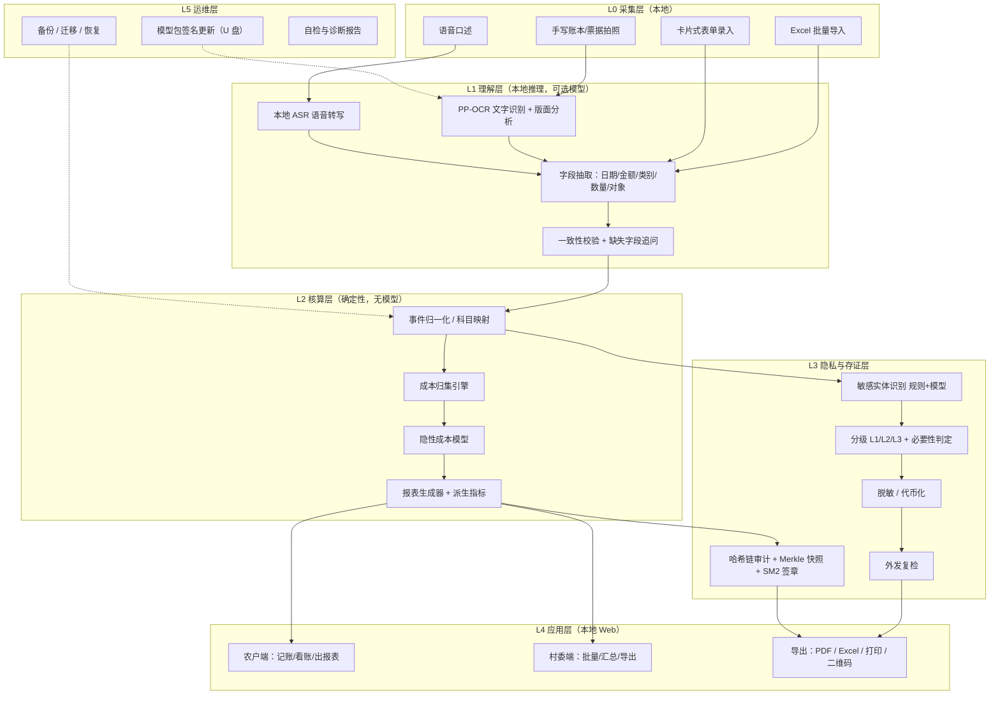
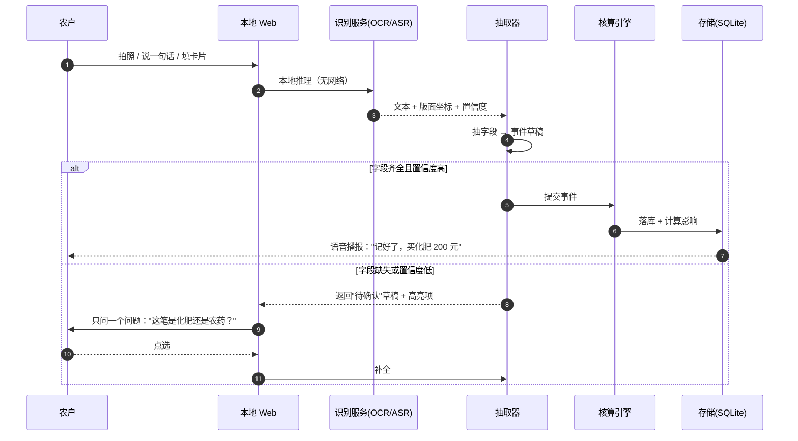
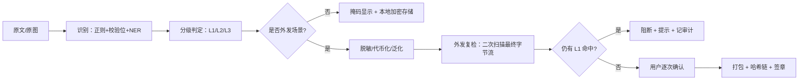

# 中小农户智能财务管理系统 · 技术方案 V2

> 项目代号：乡村财务智管家
> 版本：V2（替代 V1 申报材料中的技术描述）
> 适用范围：挑战杯创业计划竞赛 · 广东省科技创新战略专项资金（大学生科技创新培育）申报 · 后续研发执行
> 状态标记约定：**【已验证】** 已有实现与实测数据 ｜ **【目标】** 设计目标，需在里程碑内达成 ｜ **【假设】** 依赖外部条件，需在试点中校准

---

## 0. 这份文档解决什么问题

V1 的两份申报材料（挑战杯申报表、专项资金申报书）在**技术描述层面存在硬伤**：把 Mask-BERT 当作手写识别模型、宣称采集土壤与作物图像却只有一台村委办公电脑、同时声称"完全局域网不连公网"与"脱敏后上传云端"、把 SM4 与 GCM 混为一谈、给出"准确率 98%""已获农业农村部试点认可"等无法验证的表述。这些在答辩现场是**一击即破**的点。

V2 不是把 V1 的文字写得更漂亮，而是**换一套工程上站得住的技术骨架**，并把"能证明什么、暂时不能证明什么"讲清楚。核心变化只有三句：

1. **AI 只负责"看懂"，不负责"算账"。** 所有金额、成本、报表数字由确定性核算引擎产生，可逐笔复算；大模型只做抽取与建议。
2. **隐私与信用的矛盾用"可验证存证"解决，而不是靠承诺。** 原始数据不出村，但报表可以用哈希链 + Merkle 快照 + 国密签章被银行独立验证。
3. **离线是默认态，联网是受控例外。** 核心链路零网络依赖；任何外发都要经过脱敏、复检、人工确认、审计留痕四道闸。

---

## 1. 项目定义与边界

### 1.1 一句话定义

一套**部署在村集体办公电脑上、在局域网内运行、以"拍照/口述/导入"为输入、输出可审计的经营核算结果与规范化财务报表**的中小农户财务管理系统。目标不是替代会计，而是把农户"记不清、算不清、贷不到"的现状，变成"有账、有据、有凭证"。

### 1.2 服务对象与典型场景

| 角色 | 场景 | 系统提供什么 |
|---|---|---|
| 农户（40–70 岁为主） | 卖粮后想知道今年到底赚没赚 | 一页式经营摘要：收入、成本、亩均净收益、保本价 |
| 农户 | 想申请春耕贷款 | 信贷尽调版报表 + 可验证凭证包 |
| 农户 | 申报种粮补贴 / 农机补贴 | 补贴申报版报表 + 面积与投入佐证 |
| 村委经办人 | 帮 20–50 户集中记账、代报材料 | 批量录入、村级汇总看板、材料导出 |
| 银行客户经理（外部） | 核验农户经营真实性 | 只验签章与哈希，不接触原始数据 |
| 农技/农经站（外部） | 区域成本与收益监测 | 匿名化汇总指标（需单独授权） |

### 1.3 明确不做的事（范围外，写清楚比藏着好）

- **不做田间物联网**：不采集土壤墒情、气象、作物图像。V1 把"传感器数据 + 生长图像预测产量"写进采集层，但部署环境里没有传感器、没有摄像头、没有巡田人力，这条路在首版不成立（见 §7.1、§14）。
- **不做支付与放贷**：不碰资金流，不做征信结论，只产出材料。
- **不做云端 SaaS 主形态**：核心能力必须在断网机器上可用。
- **不做通用记账 App**：只做农业经营核算，不覆盖家庭消费账（可通过"生活支出"科目粗记，但不做消费分析）。
- **不做跨村数据集中**：默认单村单库，跨村汇总须显式开启并匿名化。

### 1.4 V1 → V2 的变化总览

| 维度 | V1 表述 | V2 处理 | 位置 |
|---|---|---|---|
| 识别模型 | "基于 MASK-BERT 的文本识别" | OCR 用 PP-OCR 系列，语义抽取用小模型/GLiNER，BERT 类模型不再承担"识别"职责 | §7 |
| 数据来源 | 传感器 + 图像 + 日志 + 手工 | 首版只做：拍照、语音、Excel、表单；传感器与图像移入路线图 | §1.3、§15 |
| 联网 | "完全局域网不连公网" + "脱敏后上传云端" | 本地闭环为默认；受控外发为可选功能，四道闸 | §8 |
| 加密 | "GCM 加密算法"、"SM4 国密"混用 | SM4-GCM(AEAD) + SM3 摘要 + SM2 签名，密钥分层 | §8.4 |
| 数字可信 | 由 AI "推断真实投入产出逻辑" | 数字由确定性引擎计算，AI 不得生成数字 | §3 P1、§6 |
| 指标 | "准确率 98%""覆盖 50 万农户" | 拆成可测指标 + 测量方法，区分【已验证】【目标】【假设】 | §11 |
| 凭证 | 未说明银行如何信任 | Merkle 快照 + 哈希链 + 双签章 + 三步验证协议 | §8.5 |

---

## 2. 问题建模：农户到底卡在哪

### 2.1 四个痛点 → 四个可计算的命题

把"痛点"翻译成系统里能被验证的命题，是 V2 的第一个工程动作。

| 痛点（V1 原话） | 可计算命题 | 系统对应能力 | 验收方式 |
|---|---|---|---|
| 记不清账 | 单笔记账的**录入成本**能否降到"拍照一次 / 说一句话" | OCR + ASR + 抽取 + 追问 | 单笔中位耗时、字段完整率 |
| 算不清本 | 成本口径是否**完整且可复算** | 隐性成本模型 + 事件溯源 | 与人工复核账的差异 ≤ 3%【目标】 |
| 卖不准价 | 能否给出**保本价与盈亏平衡产量** | 核算引擎派生指标 | 保本价计算可手算核对 |
| 贷不到款 | 材料能否**通过银行尽调的形式审查** | 报表模板 + 可验证凭证 | 试点村材料一次通过率 |

### 2.2 V2 的核心命题：隐私不出村 ⇔ 信用可验证

这是整个项目真正的技术难点，V1 只用"本地脱敏 + 脱敏后上传"一句话带过，逻辑上不成立：

- 银行要相信数据，就要看到**原始凭证**；
- 农户要安全感，就要求**原始数据不出村**；
- 两者直接冲突。脱敏上传只能解决"标识信息"泄露，解决不了"**银行凭什么信你算的数**"。

V2 的解法是**把"数据外发"换成"证明外发"**：

```text
不发送数据，发送三层证明：
  ① 一致性证明：报表快照 = 事件集的确定性函数（同一输入必然同一输出）
  ② 完整性证明：事件集 → 每日批次 → Merkle 根，任何增删改都会改变根
  ③ 责任证明：村委经办人 SM2 签章 + 设备指纹 + 时间戳，谁在什么时候确认的
银行核验：验签 → 比对根哈希 → 必要时经农户授权定向披露个别原始凭证
```

这套机制让"隐私不出村"与"信用可验证"从对立变成互补：银行拿到的是**可验证的最小充分证明**，而不是农户的全部账本。

---

## 3. 设计原则（五条硬约束）

以下五条是评审与实现时的裁决依据，冲突时优先级从上到下。

**P1 数字必须可复算，AI 不出数。**
任何进入报表的数字，必须能追到"哪条事件 + 哪个规则包版本 + 哪个参数包版本"。模型输出的只能是**事件**（日期、金额、类别、对象）与**建议**（这条要不要算成本），不能是合计数。理由：农业经营数据一旦被模型"估算"，就失去可审计性，银行也无法采信。工程保证见 §6.6。

**P2 离线优先，核心链路零网络。**
录入、核算、报表、隐私处理、审计全部可在断网机器完成。任何需要网络的功能都是可失败的附加项，且失败必须显式提示，不允许静默降级。

**P3 最小必要外发，默认不出村。**
系统默认**不产生任何外发流量**。外发是用户主动发起的动作，且必须经过：分层脱敏 → 外发复检（二次扫描）→ 逐次确认 → 审计留痕。

**P4 低认知负担，老年可用是硬指标。**
"功能先进但没人用"是本类项目的典型死法。可用性不做"看起来大字体"的装饰，而做可测指标：60 岁以上用户首次独立完成一次记账的耗时与成功率（§10.4）。

**P5 规则与模型可替换、可版本化。**
核算规则、区域参数、报表模板、模型权重四者独立版本化。模型升级不得改变历史报表：报表一经确认即锁定快照（§5.4）。

---

## 4. 系统架构

### 4.1 分层视图



**分层的关键不在"分了五层"，而在依赖方向**：L2 核算层对 L1 与模型**零依赖**（只吃 L1 产出的事件），因此模型换掉、模型坏了、模型没装，核算与报表照样能跑。这是"失败关闭"的另一种形式：识别失败不能导致"算不了账"，只能导致"这笔记账需要人工确认"。

### 4.2 三条端到端数据流

**(a) 记账流（最高频，必须最快）**



要点：**追问一次只问一个问题**，且永远给选项不给填空题。这是老年可用性的关键（§10）。

**(b) 出报表流**

```text
选定周期（季/年/单季作物）
  → 锁定事件集（此后记账不再进入本期，除非显式"补录"并重新生成）
  → 读取规则包版本 r、参数包版本 p
  → 引擎重算（纯函数）
  → 生成快照：{输入哈希, r, p, 输出, 时间}
  → 哈希链追加 + Merkle 根 + 签章
  → 渲染 PDF / Excel / 打印版
```

**(c) 受控外发流（可选，默认关闭）**

```text
用户发起"生成贷款材料包"
  → L3 逐字段分级：L1 一律不出现；L2 视接收方必要性决定保留/泛化；L3 保留
  → 外发复检：对最终字节流再做一次敏感实体扫描（防止拼装泄露，如"村名+姓名"）
  → 逐次确认页：明确列出"将要发送的内容"，用户点"我同意"
  → 打包：报表 PDF + 凭证清单 + 快照证明 + 签章
  → 写审计日志（谁、何时、发往何处、包含哪些字段）
```

### 4.3 模块职责

| 模块 | 职责 | 明确不做 |
|---|---|---|
| `ingest` | 收图片/音频/表格，落到 `evidence` 表，算内容哈希 | 不解析业务字段 |
| `ocr` / `asr` | 输出文本 + 坐标 + 置信度 | 不判断金额是否合理 |
| `extract` | 文本 → 事件草稿（含置信度与证据定位） | 不落正式账，不算合计 |
| `ledger` | 事件校验、科目映射、去重、补录规则 | 不调模型 |
| `costing` | 成本归集、隐性成本、派生指标 | 不读写界面状态 |
| `report` | 模板渲染、快照、签章 | 不重新计算业务语义之外的东西 |
| `privacy` | 识别、分级、脱敏、复检、审计链 | 不决定"要不要发"（那是用户的事） |
| `web` | 本地页面、语音播报、导出 | 不含业务规则 |

### 4.4 技术选型与理由

| 层 | 选型 | 理由 | 备选与不选的原因 |
|---|---|---|---|
| 运行时 | Python 3.11+ | 生态最全（OCR/ASR/小模型推理都有现成轮子），学生团队上手快 | Node 亦可，但模型侧生态弱 |
| Web 服务 | FastAPI + Uvicorn，仅监听 `127.0.0.1` | 单文件可启动，无外网监听，降低攻击面 | Electron 打包体积大、升级麻烦 |
| 前端 | 轻量 HTML + 原生 JS（或 Vue 3 编译为静态） | 断网可用、无 CDN 依赖、可离线缓存 | React SPA 对老年场景收益低、构建链更重 |
| 数据库 | SQLite（WAL 模式），按"村-年度"分库 | 零运维、单文件备份、便于整库迁移与加密 | PostgreSQL 需服务进程，村委无人维护 |
| OCR | PP-OCRv4/v5 mobile + 版面分析 | 中文印刷/手写效果好，CPU 可跑，模型小 | 云端 OCR 违规（出网）；TrOCR 手写强但中文泛化差 |
| ASR | sherpa-onnx + 中文流式/离线模型 | 完全离线、CPU 实时、体积可控 | 云端 ASR 出网；Whisper 中文短句成本高 |
| TTS | sherpa-onnx 离线 TTS | 本地播报确认，弱网可用 | 系统 TTS 各机器音色差异大，可作降级 |
| 小模型 | Qwen2.5-3B-Instruct / Qwen3-1.7B 级别 INT4 量化（llama.cpp） | 抽取歧义消解、科目建议；CPU 上 3B/4bit 尚可 | 7B 以上在 i5 无独显机器上不可用 |
| 敏感识别 | 规则（正则+校验位）+ GLiNER 类零样本 NER | 规则保底可解释，模型补长尾 | 纯模型不可解释，纯规则漏召 |
| 密码学 | SM4-GCM、SM3、SM2（国密）；Argon2id 派生口令 | 合规要求 + AEAD 提供完整性 | AES-GCM 同样可用，但涉农政务场景偏好国密 |
| 报表导出 | 服务端 HTML→PDF + openpyxl | 版面可控、可打印、可复算字段 | Word 模板易错位 |

**明确不选**：不引入 Docker/容器（村委机器装不上、也不该装）；不引入 Redis/消息队列（单机单用户并发极低）；不引入前端框架全家桶（构建复杂度换来的收益在老年场景接近零）。

### 4.5 部署形态与最低配置

```text
交付物：一个自解压/绿色目录 + 一个启动脚本
安装：复制目录 → 双击"启动.bat" → 浏览器自动打开 127.0.0.1:8765
运行：无服务注册、无管理员权限、无防火墙例外（仅环回口）
卸载：关闭窗口 + 删除目录（含加密数据库，需输入导出密码）

最低配置基线【目标】：
  Windows 10 64 位 / 4 核 CPU / 8 GB 内存 / 20 GB 空闲磁盘 / 1280×720 屏
  无独立显卡、无网络
推荐配置：i5-8250U 级别 / 8 GB / SSD（影响 OCR 与模型加载时间）
```

**性能降级策略**：检测到 4 GB 内存或机械硬盘时，自动关闭小模型（只走规则 + OCR），并在界面明示"当前为精简模式"，功能不缺失但追问次数增加。降级必须是可见的，不允许悄悄降级（P2）。

---

## 5. 数据模型

### 5.1 核心理念：事件溯源（event sourcing）

不存"结果账"，只存**事件**与**规则版本**，结果每次由事件重算。带来的好处直击本项目的痛点：

- 银行质疑某个数字 → 能导出"这个数字由哪 37 条事件按哪个规则算出"的明细；
- 农户改了一笔 → 不需要"反结账、改凭证、重算余额"这一套会计操作，重算即可；
- 模型升级或规则调参 → 历史报表**不变**（快照锁定），新报表用新版本，可对比；
- 任何一版报表都可被独立复算验证（§8.5 的验证协议依赖这一点）。

### 5.2 核心表

| 表 | 关键字段 | 说明 |
|---|---|---|
| `village` | id, name, region_code, param_pack_id | 村与区域参数包绑定 |
| `farmer` | id, token_id, display_name_enc, group | `token_id` 为对外唯一标识，真实姓名加密存储 |
| `plot` | id, farmer_id, area_mu, tenure(自有/租入), rent, soil_grade | 地块；坐标可选且默认不采集 |
| `event` | id, farmer_id, plot_id, date, type, category, amount_fen, qty, unit, counterparty_token, confidence, evidence_id, source(ocr/asr/manual/import), state(草稿/已确认/已作废), created_by | **核心表**，金额整数分 |
| `evidence` | id, sha256, path_enc, kind(img/pdf/audio), captured_at | 原始凭证；文件本身加密存放 |
| `rule_pack` | id, version, yaml_blob, effective_from | 科目映射、折旧法、折算系数开关 |
| `param_pack` | id, version, region_code, yaml_blob | 区域工价、租金、单产、价格基准 |
| `snapshot` | id, period, event_set_hash, rule_ver, param_ver, output_json, merkle_root, sig_sm2, signed_by, created_at | 报表快照，**不可变** |
| `report` | id, snapshot_id, template_id, format(pdf/xlsx), path_enc | 由快照渲染的成品 |
| `audit_log` | seq, ts, actor, action, object_ref, prev_hash, hash | 哈希链，见 §8.4 |
| `token_map` | token, cipher, scope, created_at | 代币 ↔ 明文的本地可逆映射（加密） |

### 5.3 金额与精度约定

- 金额一律 **整数分**（`amount_fen`），杜绝浮点误差；显示层除以 100。
- 数量：整数或定点两位小数（如 亩、公斤），用 `Decimal` 定点运算，禁用 `float` 参与金额链路。
- 汇率/工价等外部参数：定点 4 位小数，参数包内声明精度。
- 舍入：只在**展示**时四舍五入，计算链路不舍入；报表脚注声明"分位取整"。
- 复算一致性要求为**逐分相等**，不是"误差 0.5% 以内"——因为要经得起银行抽查。

### 5.4 快照与重放

```text
event_set_hash = SM3( 按 (date, id) 排序后逐条序列化的事件规范串 )
output_json    = CostingEngine(events, rule_pack, param_pack)   # 纯函数，无随机、无时钟
snapshot       = {event_set_hash, rule_ver, param_ver, output_json, merkle_root}
```

**重放校验**：任意时刻可用 `snapshot` 里的三个输入重跑引擎，输出必须与 `output_json` 逐字节一致，否则视为数据被篡改或代码被改动（这本身就是一种完整性检测）。参考实现见 `core/snapshot.py`，测试见 `core/tests/test_snapshot.py`。

---

## 6. 核算引擎（确定性核心）

### 6.1 科目体系：农户简易账

农户不是企业，不适用权责发生制全套。V2 采用**收付实现 + 单季作物成本归集**的混合账：

| 一级 | 二级（示例） | 说明 |
|---|---|---|
| 收入 | 主粮销售 / 经济作物销售 / 副业 / 补贴 / 其他 | 补贴单列，不计入"经营收入"以免虚高 |
| 变动成本 | 种子种苗 / 化肥 / 农药 / 农膜 / 灌溉电费 / 燃料 / 机械作业费 / 雇工 / 运输 / 销售费用 | 随面积或产量变动 |
| 固定成本 | 土地租金 / 自有土地机会成本 / 农机折旧 / 设施折旧 / 保险 / 管理费 | 与当期产量弱相关 |
| 隐性成本 | 自用工 / 家庭劳动机会成本 / 资金占用成本 | V1 的核心卖点，见 §6.3 |
| 资产与负债 | 农机原值 / 累计折旧 / 存货 / 借款 | 供折旧与资金成本计算 |

### 6.2 显性成本

按事件直接归集：`Σ amount_fen`，按二级科目与地块分组。规则包负责"类别 → 科目"的映射（如"复合肥"→化肥），映射表可配置，避免把农资商的名字当科目。

### 6.3 隐性成本模型（V1 的核心主张，V2 给出可核算定义）

V1 只说"引入标准劳动折算系数、农机使用寿命模型与土地年化折旧模型"，没有公式。V2 定义如下，全部参数化、可覆盖、可在报表脚注中摊开：

**(1) 自用工成本**

```text
自用工成本 = Σ_环节 ( 工时 h_i × 当地该环节雇工日工价 p_i / 8 ) × 折算系数 α
```

| 参数 | 含义 | 默认 | 来源 |
|---|---|---|---|
| `h_i` | 环节工时（播种/插秧/施肥/打药/灌溉/收割/晾晒/销售） | 按面积×区域定额 | 区域参数包（农技站定额或调研） |
| `p_i` | 该环节当地雇工日工价（元/工日） | 区域参数包 | 县域统计/劳务市场调研，年度更新 |
| `α` | 家庭劳动影子工资折价系数 | **0.7** | 【假设】区间 0.6–0.8；农业经济学对家庭劳动机会成本的常见折价做法，可在参数包覆盖，报表需声明取值 |

**为什么要有 α**：家庭自用工的机会成本不等于雇工市场价（农闲时机会成本低、无社保成本、劳动强度自定）。直接用市场价会把自用工算高、把收益算负，反而失去参考价值。α 在报表中必须**明示取值并给敏感性区间**（§6.5），不允许隐藏。

**(2) 自有农机折旧（工作量法为主）**

```text
年折旧额 = (购置价 - 残值) × (本年作业量 / 设计总作业量)
累计折旧 ≤ 购置价 - 残值    （硬约束，超限即封顶）
```

- 残值率默认 5%；设计总作业量按机型查参数包（如旋耕机 8000 亩、收割机 3000 亩、植保无人机 15000 亩）。
- 同时提供**年数总和法**作为可选（`depreciation_method: workload | sum_of_years`），因为部分机型无可靠作业量记录。
- 台账未记录作业量时，用"面积 × 作业次数"估算并标注 `estimated=true`，报表脚注统计"含估算项占比"。

**(3) 土地成本**

```text
自有地：土地机会成本 = 面积 × 当地同等地力流转租金（元/亩·年）
租入地：土地成本   = 实付租金（事件） + 押金资金成本（可选）
```

用"流转租金"而非"土地产值分成"，因为前者是农户可观测、可谈判的市场价格，解释成本低。

**(4) 资金占用成本（可关闭）**

```text
资金成本 = Σ ( 垫资额 × 短期涉农贷款利率 × 占用月数 / 12 )
```

默认关闭，因为多数农户不认这笔账；开启后在报表中单列。

### 6.4 收益、保本价与盈亏平衡

```text
总产值   = Σ(销量 × 售价) + 期末存货估值（按可变现价，默认不计）
总成本   = 变动成本 + 固定成本 + 隐性成本
净收益   = 总产值 - 总成本
亩均净收益 = 净收益 / 面积
```

**保本价**（农户最需要的那个数）：

```text
保本价 p* = (总成本 - 非销售性收入) / 可售数量
```

必须给**两个口径**，因为农户卖粮时价格包含不同环节：

| 口径 | 含义 | 用途 |
|---|---|---|
| 地头保本价 | 不含运输与销售费用 | 粮贩上门收购时的谈判底线 |
| 到场保本价 | 含运输、装卸、烘干、销售费用 | 自己拉去粮库/合作社时 |

**盈亏平衡产量**：`q* = 固定成本 / (单价 - 单位变动成本)`，用于"今年种多少才不亏"。

### 6.5 敏感性与区间输出

单点数字会误导（α 取 0.6 还是 0.8，结论可能从"赚"变"亏"）。V2 强制输出区间：

```text
对 α、单产、售价 三因素做 ±20% 的情景组合（27 组或简化 3 组），
输出：基准值 / 悲观值 / 乐观值 / 最敏感因素
报表页脚："在自用工折算系数 0.6–0.8、售价 ±20% 的情形下，净收益区间为 X–Y 元；
          影响最大的因素是【售价】。"
```

这既是技术诚实，也是产品优势：农户要的是"卖到这个价我就不亏"，不是一个精确到元的假数字。

### 6.6 可复算性的工程保证（四条）

1. **纯函数**：`CostingEngine.compute(events, rule_pack, params)` 不读文件、不读时钟、不联网、不随机。
2. **无隐藏状态**：引擎不依赖数据库当前状态，只依赖传入的事件列表与版本号。
3. **金额整数分 + 定点**：全链路无 `float`；已用单元测试覆盖（`core/tests/test_costing.py`）。
4. **重放校验**：快照内保存 `event_set_hash` 与完整 `output_json`，随时可重算比对（§5.4）。

### 6.7 参考实现

仓库 `core/` 给出核算引擎的**可运行最小实现**（6 个模块、约 850 行含注释，纯标准库，无第三方依赖）：

| 文件 | 内容 |
|---|---|
| `money.py` | 整数分 + 定点运算、安全除法、显示格式化 |
| `models.py` | Event / Plot / Params / RulePack 数据类与校验 |
| `costing.py` | 显性/隐性成本、折旧（工作量法/年数总和法）、保本价、盈亏平衡 |
| `reports.py` | 经营摘要、成本结构表、敏感性区间 |
| `snapshot.py` | 事件集规范化哈希、快照生成与重放校验 |
| `tests/` | 覆盖折旧封顶、α 区间、保本价两口径、复算一致性 |

它不是产品，但它是**答辩时最有说服力的东西**：把一份示例账本跑出报表，再把报表重放一次，数字逐分相同。

---

## 7. AI 层：只做抽取与建议

### 7.1 V1 的模型误用与更正

V1 写"基于 MASK-BERT 的文本识别"、"开发 Mask-BERT 模型训练"、"优化 Mask-BERT 模型性能，通过对比学习与锚样本策略提升长尾类别"。这里有两个问题：

1. **Mask-BERT 是中文掩码语言模型（知识增强 BERT），不是文字识别模型。** 它不处理图像，无法"识别手写记账笔记"。把它写成 OCR 是本方案最容易被评委击穿的地方。
2. **"长尾类别与细粒度分类"与业务目标对不上。** 农户账目的关键不是我分得多细，而是**金额、日期、类别对不对，且能不能确认**。

V2 的模型分工：

| 任务 | 输入 | 模型 | 输出 |
|---|---|---|---|
| 文字识别 | 图片 | PP-OCR 检测 + 识别（mobile） | 文本 + 坐标 + 置信度 |
| 版面理解 | 图片 | 版面分析（表格/票据区域） | 区域标签，供字段定位 |
| 语音转写 | 音频 | 离线 ASR（sherpa-onnx） | 文本 + 时间戳 |
| 字段抽取 | 文本 | 规则模板 + 小模型（Qwen 级 INT4）或 GLiNER 零样本 | 事件草稿（含证据跨度） |
| 歧义消解 | 文本 + 少量上下文 | 小模型 | "这笔算化肥还是农药"的单选建议 |
| 敏感实体识别 | 文本 | 正则 + 校验位 + NER | L1/L2 实体与位置 |

**分工原则**：越靠近"钱"的环节越不能用模型拍板；越靠近"文本理解"的环节越可以用模型。

### 7.2 抽取输出契约

```jsonc
{
  "date":   {"value": "2026-04-12", "conf": 0.93, "span": [12, 22]},
  "amount": {"value": 20000, "currency": "CNY", "conf": 0.88, "span": [38, 45]},  // 分
  "category": {"value": "化肥", "conf": 0.71, "span": [30, 32], "alternatives": ["农药"]},
  "qty":    {"value": 50, "unit": "kg", "conf": 0.90},
  "counterparty": {"token": "T-8823", "conf": 0.80},
  "evidence_id": "E-1024",
  "needs_confirm": ["category"]
}
```

- 每个字段独立置信度，**字段级确认**而不是整条确认（农户只需回答一个点）。
- `needs_confirm` 非空则必须走追问，且追问最多 2 轮，超时降级为手工输入（不允许卡死）。
- `alternatives` 用于给"单选题"的两个选项，避免开放式提问。

### 7.3 人机协同规则（不允许模型"猜钱"）

| 情形 | 处理 |
|---|---|
| 金额置信度 < 0.85 | 强制确认，展示原图裁剪区域供对照 |
| 金额缺失但文本有其他数字 | 只给候选，不自动填入 |
| 类别置信度 < 0.8 | 单选题二选一（基于 `alternatives`） |
| 日期缺失 | 默认今天，但界面高亮且可一键改 |
| 抽取结果与历史同类均值偏差 > 5 倍 | 提示"这笔金额比往常大很多，确认一下？" |

"偏差 > 5 倍"这条是本方案少见的**正向利用历史数据**的地方：它不需要复杂模型，却能拦住绝大多数录入错误（多打一个 0）。

### 7.4 体积与性能预算

| 组件 | 模型体积【目标】 | 常驻内存【目标】 | 单次耗时（i5-8250U/8G）【目标】 |
|---|---|---|---|
| OCR（检测+识别+方向） | ≤ 25 MB | ≤ 300 MB | ≤ 1.2 s / 张 |
| 版面分析（lite） | ≤ 10 MB | ≤ 150 MB | ≤ 0.4 s / 张 |
| ASR（离线中文） | ≤ 120 MB | ≤ 300 MB | 实时率 ≤ 0.3 |
| 小模型 3B INT4 | ≤ 2.2 GB | ≤ 1.6 GB | 首 token ≤ 1.5 s |
| 合计安装包 | ≤ 500 MB | 峰值 ≤ 2.0 GB | 端到端记账 P95 ≤ 3 s |

预算不达标时的降级顺序：小模型关 → 版面分析关 → ASR 关（保留 OCR）。**任何降级都要在界面可见**。

### 7.5 模型更新与回滚

- 更新包 = 单个签名文件（SM2 签名 + 版本号 + 目标机型）；导入前校验签名，校验失败拒绝更新。
- U 盘分发（村委无外网），更新后自动跑自检用例（10 张标准票据 + 5 条标准语音），通过率 < 90% 自动回滚。
- 模型版本写入 `event` 的 `source` 元数据，便于事后追责"这批错误是哪个版本产生的"。

---

## 8. 隐私计算与可信存证（V2 的核心技术主张）

### 8.1 三级分类

| 级别 | 内容 | 默认处理 | 是否可外发 |
|---|---|---|---|
| **L1 直接标识** | 身份证号、银行卡号、手机号、真实姓名、精确住址、地块坐标、人脸/指纹 | 本地加密存储，界面掩码显示，仅参与计算不作输出 | **禁止**（任何情况下不出村） |
| **L2 准标识** | 村组、地块面积、作物结构、交易对手（粮贩/农资商）、贷款用途 | 本地保留；外发时按接收方必要性决定"保留 / 泛化（区间化）/ 代币化" | 条件允许（逐字段判定 + 用户确认） |
| **L3 经营汇总** | 成本结构、收益、亩产、面积合计 | 可外发 | 允许（最小必要范围内） |

关键设计：**L1 不是"脱敏后可以发"，而是"结构上不可能出现在外发包里"**——外发打包器只从 L3/L2 白名单渲染，L1 字段在数据模型里就没有通往模板的路径（不是靠运行时过滤，靠结构消除）。

### 8.2 本地处理链（五步）



**校验位是规则层的价值所在**：身份证 ISO 7064 校验、银行卡 Luhn 校验、手机号段校验，把"看起来像号码"和"真的是号码"分开，显著降误报。规则可解释、可审计，模型只补长尾（如姓名、地名、关系人）。

**外发复检为什么必要**：单字段脱敏会漏掉**组合泄露**——报表本身不含姓名，但"XX 村 3 组、种植 42 亩砂糖橘的唯一农户"在村内是唯一可指的。复检按"L2 准标识组合 + 村内唯一性"规则做二次判定，必要时把面积泛化为区间（"40–50 亩"）。

### 8.3 代币化与可逆映射

```text
token = "F-" + base32( SM3( 村ID || farmer_id || 设备密钥 )[0:10] )
```

- 对外（报表、外发包、日志）一律用 token，不用姓名。
- 本地保留 `token_map(token → 加密明文)`，密钥为设备主密钥（KEK）包裹的数据密钥（DEK），DEK 由村委管理员口令 + 设备指纹派生的 KEK 保护（Argon2id）。
- 农户换村/离网迁移：导出加密包 + 口令，导入端解密后重建映射（不依赖云端）。

### 8.4 哈希链审计 + Merkle 快照 + 国密签章

**审计日志哈希链**（防篡改、防删除）：

```text
hash_0 = SM3("GENESIS" || village_id)
hash_n = SM3( hash_{n-1} || ts || actor || action || object_ref || payload_digest )
```

任何一条被改动或删除，其后所有 hash 都对不上；校验只需 O(n) 重算，或抽查最后一条 + 定期锚点。

**事件批次 Merkle**：

```text
叶子   = SM3( 规范化事件串 )
父节点 = SM3( left || right )（奇数补自身）
根     = merkle_root  → 写入 snapshot
```

**签章**：`snapshot` 由村委经办人 SM2 私钥（存于 UKey 或加密文件）+ 设备标识共同签名。双要素的意义：单靠设备，村委可以说"不是我签的"；单靠人，农户可以说"设备被改过"。

### 8.5 银行/补贴部门的三步验证协议（本方案的关键交付）

```text
第 1 步 验签：用村委公钥验证 snapshot.sig_sm2 有效，且 snapshot 未被改
第 2 步 验根：按报表附带的"事件清单元数据"（条数、日期范围、逐条摘要的 Merkle 路径可选）
             重算 merkle_root，与 snapshot 中的根一致
第 3 步 抽验（可选，需农户单次授权）：
             银行指定"3 月的化肥支出"→ 系统定向披露该笔事件的原始票据图片与金额
             只披露这一笔，其余仍不出村
```

**这套协议的好处**：

- 银行不需要拿走全量数据，也能确认"报表与账本一致、账本未被事后修改、有人对它负责"；
- 农户的隐私边界从"全给或全不给"变成"按需披露一笔"；
- 技术上全部可在离线机器完成，不需要区块链、不需要第三方平台。

**诚实说明局限**：本协议证明的是"**账本没被改、报表忠实于账本、签章人对此负责**"，不证明"农户没有造假账"。防造假靠抽验原始票据 + 交叉核对（如与农资商的采购记录）——这部分属于业务风控，不是密码学能解决的。**申报材料里不要把"可验证"说成"防造假"**。

### 8.6 合规映射

| 要求 | 依据 | 本方案落实 |
|---|---|---|
| 最小必要 | 《个人信息保护法》第 6 条 | L1 结构上不可外发；外发字段白名单 |
| 告知同意 | 第 14、17 条 | 首次使用告知书（图文+语音版）；外发逐次确认页 |
| 单独同意 | 第 23、29 条 | 外发、敏感信息处理单独勾选，不默认勾选 |
| 去标识化 | 第 73 条 | 代币化 + 泛化，且保留再识别所需额外信息（密钥分离） |
| 个人信息保护影响评估 | 第 55、56 条 | 试点前完成 PIA 文档（数据流图 + 风险 + 处置） |
| 数据安全 | 《数据安全法》分类分级 | L1/L2/L3 三级，村级单库隔离 |
| 密码合规 | 商用密码应用要求 | SM2/SM3/SM4，密钥分级与生命周期管理 |

**角色划分需要写清**（答辩常问）：村集体是数据处理者（决定处理目的），项目团队是受托技术提供方，双方签数据处理协议；团队不接触生产数据，只接收脱敏后的缺陷样本用于模型迭代。

---

## 9. 报表规范化

### 9.1 三类模板

| 模板 | 面向 | 核心内容 | 典型字段 |
|---|---|---|---|
| **T1 信贷尽调版** | 银行/担保/农担 | 经营真实性 + 还款能力 | 经营面积、近 3 年收入、成本结构、净收益、负债、现金流、资产（农机/存货） |
| **T2 财政补贴版** | 农业农村局/财政 | 补贴资格与投入佐证 | 申报面积、地块清单、投入明细、作业记录、购销凭证索引 |
| **T3 经营主体备案版** | 农经站/市场监管 | 主体基本信息与年报口径 | 主体信息、从业人员、资产、收入、成本、盈余 |

### 9.2 字段级映射（示例，T1 节选）

| 报表字段 | 来源 | 计算/映射规则 | 缺失处理 |
|---|---|---|---|
| 经营耕地面积 | `plot.area_mu` 合计 | 自有 + 租入，分作物 | 必填，缺失阻断 |
| 年度经营收入 | `event(收入)` | Σ 主粮 + 经济作物 + 副业（**不含补贴**） | 允许 0，需确认 |
| 物化成本 | `event(变动成本)` | 种子+化肥+农药+农膜+灌溉+燃料 | 允许部分缺失，标注 |
| 机械作业成本 | `event` + `折旧` | 外包作业费 + 自有农机折旧 | 允许 |
| 人工成本 | `event(雇工)` + 自用工 | 雇工实付 + 自用工模型值（分列） | 自用工可关闭 |
| 净收益 | 引擎派生 | 收入 - 总成本 | 必算 |
| 资产负债 | `event(资产/负债)` | 农机净值、存货、借款余额 | 允许 0 |

**关键设计：显性/隐性分列，不合并。** 银行看的是"现金成本"和"真实成本"两个数；把自用工折算混进"人工成本"会让银行误判现金流。分列既专业，也避免"数据不可信"的指控。

### 9.3 版本化与可解释性

- 模板带版本号（`T1-v3`），模板变更必须新建版本，历史报表按旧版本渲染（存档一致性）。
- 每个报表数字可点开"来源"：事件列表 + 规则条款 + 参数取值。
- 报表脚注固定打印：规则包版本、参数包版本、α 取值、估算项占比、生成时间、快照哈希前 16 位、签章人。

### 9.4 导出与打印

- PDF：A4，适配黑白激光打印（不依赖彩色区分）。
- Excel：字段与 PDF 一一对应，便于银行二次加工；金额列**同时给分与元**，避免对方单位误读。
- 打印版：一页摘要（给农户自己看）+ 多页明细（给机构看）。
- 二维码：印在纸质报表上，扫码可在村委内网查验证书（离线局域网内），或核验哈希。

---

## 10. 人机交互与可用性

### 10.1 老年友好基线（可测，不是形容词）

| 项 | 基线 | 说明 |
|---|---|---|
| 正文字号 | ≥ 20 px（约 15 pt） | 金额 ≥ 28 px |
| 对比度 | ≥ 4.5:1（正文）/ ≥ 3:1（大字） | 避免浅灰字 |
| 触控/点击目标 | ≥ 44 × 44 px | 考虑手抖与手套操作 |
| 单页任务数 | 1 个 | 不做"多 tab 表单" |
| 完成一次记账步数 | ≤ 3 步 | 拍照/说话 → 确认 → 完成 |
| 追问次数 | ≤ 2 次，每次 1 个问题 | 给选项不给填空 |
| 术语 | 零财务术语 | "本钱/卖了多少/赚了多少"而非"成本/收入/净利" |
| 撤销 | 一步撤销，30 秒内可撤 | 误触不怕 |

### 10.2 语音双向

- **TTS 播报**：每笔记账后用方言/普通话播报确认（"买化肥两百块，记好了"）。播报文本短于 20 字，语速可调（0.8×/1.0×）。
- **ASR 口述**：支持"今天买化肥花了两百块"这类口语，抽取后**先播报再落账**，播报即确认。
- **方言兜底**：不承诺方言识别精度【假设】；提供"录音 + 村委代录"流程，录音本地留存待复核。
- **隐私**：语音不离开本机，识别在本地完成；录音默认 30 天后自动删除（可配置）。

### 10.3 三个核心页面（低保真描述）

**页面 1 · 今日记账（默认首页）**
四个大按钮：`📷 拍张照`、`🎤 说一句`、`➕ 手动记`、`📋 看这个月`。下方是本月三行大字：收入 / 支出 / 结余。

**页面 2 · 待确认（只在需要时出现）**
顶部一张原图裁剪（高亮区域），中间一句话问题："这是化肥还是农药？"，下面两个大按钮。右下角"都不是，我自己填"。

**页面 3 · 年度账本（一页看完）**
上半部：净收益大字 + 区间（"大约赚 1.2 万，可能在 0.8–1.6 万之间"）。
下半部三张卡片：`钱花在哪了`（成本结构条形）、`卖多少钱不亏`（保本价）、`能贷多少`（材料准备度）。
底部两个按钮：`导出给银行`、`打印一份`。

### 10.4 可用性验收方法

| 指标 | 方法 | 目标 |
|---|---|---|
| 首次独立记账完成率 | 招募 10 名 60+ 农户，无指导，完成 3 笔记账 | ≥ 85%【目标】 |
| 单笔记账中位耗时 | 同上，计时 | ≤ 90 s |
| 任务后主观评分 | SUS 量表（中文版） | ≥ 75【目标】 |
| 求助率 | 观察记录"需要人帮"次数 | ≤ 1 次/3 笔 |
| 误操作恢复率 | 故意误触后能否自行恢复 | ≥ 90% |

**不达标就砍功能，不是加说明。** 这条写进验收，防止"功能越来越多、越来越没人用"。

---

## 11. 指标体系与验收

### 11.1 功能与质量指标

| 编号 | 指标 | 定义 | 目标 | 状态 |
|---|---|---|---|---|
| F1 | 记账字段完整率 | 事件必填字段齐全的比例 | ≥ 95% | 【目标】 |
| F2 | 印刷票据金额抽取 F1 | 标准票据测试集 | ≥ 0.95 | 【目标】 |
| F3 | 手写账本金额抽取 F1 | 手写测试集（≥200 张） | ≥ 0.85 | 【目标】 |
| F4 | 日期抽取 F1 | 同上 | ≥ 0.95 | 【目标】 |
| F5 | 类别判定 Top-2 命中率 | 类别及备选含正确项 | ≥ 0.92 | 【目标】 |
| F6 | 核算复算一致性 | 同输入重放逐分相等 | 100% | **【已验证】**（`core/` 单测） |
| F7 | 报表字段完整率 | T1/T2 必填字段非空比例 | 100%（缺失必填即阻断） | 【目标】 |
| F8 | 单笔记账端到端耗时 | 拍照到落账 P95 | ≤ 3 s | 【目标】 |
| F9 | 报表生成耗时 | 1 万事件生成 T1 | ≤ 1 s | 【目标】 |
| F10 | 常驻内存峰值 | 全功能开启 | ≤ 2.0 GB | 【目标】 |
| F11 | 安装包体积 | 含全部模型 | ≤ 500 MB | 【目标】 |
| F12 | 离线可用率 | 断网下核心链路成功率 | 100% | 【目标】 |
| F13 | L1 外发泄露率 | 500 例对抗测试集（含组合泄露） | 0 | 【目标】 |
| F14 | 审计链篡改检出率 | 随机改动 1 条日志 | 100% | **【已验证】**（`core/` 单测） |
| F15 | 快照重放一致率 | 同上 | 100% | **【已验证】** |
| F16 | 老年用户首次完成率 | §10.4 方法 | ≥ 85% | 【目标】 |

### 11.2 与 V1 指标的对照（务必替换掉 V1 的表述）

| V1 原文 | 问题 | V2 替换为 |
|---|---|---|
| "AI 分析准确率提升至 98% 以上" | 未定义"准确率"是什么；98% 无来源 | 拆成 F2/F3/F4/F5 四个分项，各自给测试集与目标 |
| "推理效率提升 50% 以上" | 相对谁？基线未定义 | F8 端到端 P95 ≤ 3 s（绝对指标，可复现） |
| "审核效率提高 70%" | 谁审核、怎么算的效率 | 银行尽调材料"一次通过率"（试点中测量） |
| "成本核算效率提高 60% 以上" | 相对"记忆记账"，无法测量 | 单笔记账耗时（实测）+ 人工复核工时对比 |
| "3 年内覆盖超 50 万农户" | 无落地路径支撑的规模断言 | 改为"3 年内在 3 个县、30 个村完成部署"（可执行） |
| "已获农业农村部试点认可" | **不可背书，风险极高** | 删除。改为"与 X 村/合作社达成试点意向"（须有据） |
| "ROI 超 150%" | 未给成本项与周期 | 改为"村级部署年成本 ≤ X 元，对照农户材料代办市场价 Y 元" |

**给申报材料的建议**：凡是要写数字，必须能回答"这个数怎么测的、现在测到多少、没测到就写目标"。评委不讨厌没做到，讨厌说不清。

---

## 12. 实施计划（7 个月）

### 12.1 里程碑

| 阶段 | 月 | 交付物 | 退出条件 |
|---|---|---|---|
| **M1 内核** | 1–2 | 事件模型、核算引擎、参数包 v0、Excel 导入、T1 报表 | 用 3 户真实（脱敏）账本跑出报表，人工复核差异 ≤ 5% |
| **M2 核算校准** | 2–3 | 隐性成本模型校准、敏感性分析、参数包 v1（1 个县） | 与农经站核算结果对比，隐性成本口径获认可 |
| **M3 识别** | 3–4 | OCR/ASR 接入、抽取器、追问流程 | F2 ≥ 0.95、F3 ≥ 0.85（自建 300 张测试集） |
| **M4 隐私与存证** | 4–5 | 分级、脱敏、复检、哈希链、快照签章、验证工具 | F13/F14/F15 达标；第三方（指导老师）按 §8.5 验签成功 |
| **M5 交互** | 5–6 | 老年 UI、语音播报、打印版 | §10.4 招募测试达标（≥85%/SUS≥75） |
| **M6 试点** | 6–7 | 1–2 个村部署、培训材料、运维手册 | 连续 4 周稳定运行；≥20 户真实使用 |
| **M7 材料对接** | 7 | T1/T2/T3 模板定稿、银行/农经站意见、演示视频 | 至少 1 家机构确认报表格式可用 |

### 12.2 团队分工（与两份申报材料统一后的口径）

| 成员 | 专业/年级 | 职责 | 对应模块 |
|---|---|---|---|
| 龙腾雨 | 网安 本科一年级 | 项目负责人：需求调研、系统集成、交互设计、进度 | `web`、需求、验收 |
| 陈炜昊 | 网安 本科三年级 | 技术负责人：架构、本地推理、隐私架构 | `ocr`/`extract`/`privacy` |
| 王宛韵 | 财务管理 本科二年级 | 核算口径、报表模板、参数与合规 | `costing`、`report`、T1–T3 |
| 郑文奎 | 网安 本科一年级 | 隐私计算与密钥管理 | `privacy`、密码模块 |
| 唐青滢 | 网安 本科一年级 | 数据工程、测试集建设 | 数据集、F2–F5 评测 |
| 宋嘉烨 | 网安 本科一年级 | 前端与可用性、语音交互 | `web`、TTS/ASR 接入 |
| 雷稳（指导） | 实验师 | 技术指导、资源协调、合规把关 | 全流程 |

> 注意：V1 材料中挑战杯写 5 人、专项资金写 4 人且缺宋嘉烨；对外必须统一为这个 7 人（6 学生 + 1 教师）版本。

### 12.3 资源需求

| 项 | 需求 | 说明 |
|---|---|---|
| 硬件 | 2 台测试机（i5/8G 最低配 + 一台 4G 低配用于降级测试） | 现有设备可满足 |
| 数据 | 300 张票据/手写样本、100 条语音、3 户完整年度账本 | 需村委协助，签署授权 |
| 场地 | 1–2 个试点村、村委办公室电脑 1 台 | 关键外部依赖【假设】 |
| 外部支持 | 农经站核算口径、1 家银行尽调清单、1 名会计顾问 | 决定报表模板质量 |
| 经费 | 设备/差旅/数据标注/专家咨询 | 按专项资金预算表列 |

---

## 13. 风险登记册

| # | 风险 | 概率 | 影响 | 对策 | 触发信号 |
|---|---|---|---|---|---|
| R1 | 拿不到村委试点与真实账本 | 中 | 高 | 先做"模拟账本 + 公开统计参数"的全链路演示；同步谈 2 个备选村 | 第 3 月仍无试点意向 |
| R2 | 手写识别精度不达标 | 高 | 中 | 人机协同（强制确认）兜底；精度是加分项不是生死项 | F3 < 0.8 |
| R3 | 银行不认自制报表格式 | 中 | 高 | M1 就去找 1 家机构要对公模板；不自造格式 | 机构反馈"格式不可用" |
| R4 | 隐性成本口径被质疑"算得太虚" | 高 | 中 | 显性/隐性分列；α 与参数全部公开；给区间不给点值 | 农经站不认可 |
| R5 | 设备性能不足（4G/机械盘） | 中 | 中 | 降级模式 + 明确基线；安装前自检 | F8 超 3 s |
| R6 | 合规风险（PIA、授权书缺失） | 中 | 高 | 试点前完成 PIA 与告知同意文书；不采集身份证原件图像 | 无授权书即停 |
| R7 | 团队人力（本科课业冲突） | 高 | 中 | 里程碑按"最低可交付"设计；每阶段留 1 周缓冲 | 连续 2 周无进展 |
| R8 | 被质疑"就是个记账 App" | 中 | 高 | 用"可验证凭证 + 离线核算"与 App 划清界限；现场演示验签 | 评审提问集中于功能 |

---

## 14. 与同类方案对比

| 对比对象 | 它们强在哪 | 它们的缺口 | 本方案的位置 |
|---|---|---|---|
| 记账类 App（随手记、农管家等） | 体验成熟、免费 | 消费记账口径，不做经营核算；数据在云端；老年不友好 | **不做通用记账，只做经营核算 + 凭证** |
| 银行信贷系统 | 风控强、资金端强 | 只消费数据，不生产数据；农户拿不到自己的账 | 做"数据生产端"，输出银行可验的材料 |
| 农业 SaaS / 数字乡村平台 | 功能全、有政企渠道 | 需联网、按年费、依赖运营商维护；村委无人会用 | 离线、零运维、老年可用 |
| 遥感/物联网产量预测 | 大尺度、精度高 | 单户小地块不经济；设备与运维成本高 | 首版不做，作为 V3 的可选证据源 |
| 通用 LLM 记账助手 | 交互自然 | 数字不可复算、不可审计；隐私出网 | LLM 只做抽取，数字由引擎算 |

**一句话定位**：在"离线可用的经营核算" × "可验证的信用凭证" × "老年可用" 三者的交集里，目前没有成型产品。

---

## 15. 演进路线

**V2（本期）**：单村单机、事件溯源核算、OCR/ASR 抽取、隐私分级与脱敏、可验证快照、T1–T3 报表、老年 UI。

**V3（下一期，条件触发）**：
- 多村联邦汇总：各村本地算聚合指标，只上送匿名化汇总量（联邦式，不上传明细）；
- 产量与价格预测：接入县域单产/价格基准 + 可选遥感，做区间预测；
- 与农资/收购方对接：电子购销凭证直接入账（减少录入）；
- 移动端辅助：仅做"拍照上传到本村机器"，不做独立 App。

**明确不进 V3 的**：P2P 放贷、征信评分、跨境数据、任何形式的原始数据集中存储。

---

## 附录 A：术语

| 术语 | 含义 |
|---|---|
| 事件（Event） | 一次经营行为的结构化记录（日期、金额、类别…），系统的最小事实单元 |
| 事件溯源 | 只存事件与规则版本，结果每次重算的架构 |
| 快照（Snapshot） | 某一期报表的输入哈希 + 规则版本 + 输出 + 签名，不可变 |
| Merkle 根 | 事件集的哈希树根，任何增删改都会改变它 |
| 代币化 | 用 token 替换真实标识，本地保留加密映射 |
| L1/L2/L3 | 直接标识 / 准标识 / 经营汇总 三级数据分类 |
| α | 家庭自用工的影子工资折价系数，默认 0.7，区间 0.6–0.8 |
| 保本价 | 使净收益为零的售价，分"地头"与"到场"两个口径 |

## 附录 B：参数包字段（`param_pack.yaml` 节选）

```yaml
region_code: "4401xx"          # 县域代码
version: "2026.1"
labor:
  day_wage: {播种: 150, 插秧: 180, 施肥: 140, 打药: 160, 灌溉: 130, 收割: 170, 晾晒: 120}
  hours_per_mu: {播种: 0.8, 施肥: 0.5, 打药: 0.6, 灌溉: 0.4, 收割: 1.2}
  shadow_wage_alpha: 0.70      # 0.6–0.8
land:
  rent_per_mu: {水田: 800, 旱地: 500, 果园: 1200}
machinery:
  - {name: 旋耕机, price: 12000, residual_rate: 0.05, design_total_mu: 8000, method: workload}
  - {name: 联合收割机, price: 120000, residual_rate: 0.05, design_total_mu: 3000, method: workload}
yield_baseline:                # 区间，不给单点
  水稻: {low: 450, mid: 520, high: 600}   # 公斤/亩
price_baseline:
  水稻: {low: 2.2, mid: 2.6, high: 3.0}   # 元/公斤
```

## 附录 C：事件 JSON Schema（节选）

```jsonc
{
  "type": "object",
  "required": ["id", "farmer_token", "date", "type", "category", "amount_fen"],
  "properties": {
    "id": {"type": "string", "pattern": "^E-[0-9]{6}$"},
    "farmer_token": {"type": "string", "pattern": "^F-[A-Z2-7]{10}$"},
    "plot_id": {"type": ["string", "null"]},
    "date": {"type": "string", "format": "date"},
    "type": {"enum": ["income", "variable_cost", "fixed_cost", "asset", "liability"]},
    "category": {"type": "string"},
    "amount_fen": {"type": "integer", "minimum": 0},
    "qty": {"type": ["string", "null"], "description": "定点小数字符串，如 '50.00'"},
    "unit": {"type": ["string", "null"]},
    "counterparty_token": {"type": ["string", "null"]},
    "confidence": {"type": "number", "minimum": 0, "maximum": 1},
    "evidence_id": {"type": ["string", "null"]},
    "source": {"enum": ["ocr", "asr", "manual", "import"]},
    "state": {"enum": ["draft", "confirmed", "voided"]},
    "estimated": {"type": "boolean", "default": false}
  }
}
```

---

## 附：本方案与 V1 材料的替代关系

拿到这份文档后，两份申报材料里所有涉及"技术如何实现"的段落，按以下方式替换：

| V1 位置 | 替换为本文档 |
|---|---|
| 挑战杯申报表"创新意义"四段 | §1.4 + §2.2 + §6.3 + §8.5（四条创新各配一个可验证机制） |
| 挑战杯申报表"发展前景"规模与 ROI 断言 | §11.1 指标 + §12.1 里程碑 |
| 专项资金申报书"基本思路/整体架构" | §4、§6、§7、§8 |
| 专项资金申报书"研究内容" | §12.1 里程碑 + §15 路线 |
| 专项资金申报书"关键问题" | §13 风险登记册 |
| 两份材料的"预期成果"数字 | §11.2 对照表（逐条替换） |

详见 `docs/V1诊断与修订对照.md`（逐条问题清单）与 `docs/对外表述口径与答辩要点.md`（统一口径与预判问答）。
